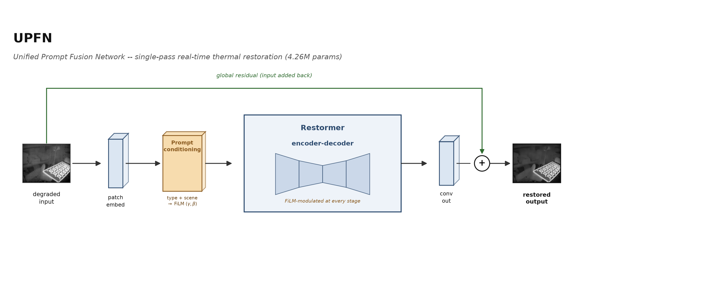
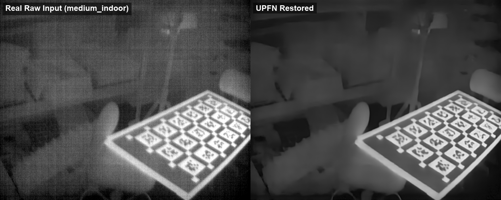
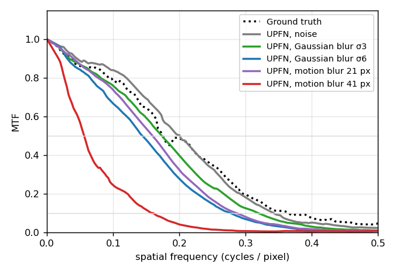

# UPFN

**Unified Prompt Fusion Network**: single-frame restoration of 16-bit raw thermal frames. Sensor noise,
motion blur and illumination degradation are removed together in one forward pass.

- 4.26M parameters
- 66.9 FPS (fp16 + `torch.compile`, 24 GB GPU)
- Restormer encoder-decoder with FiLM prompt conditioning

## Architecture

<div align="center">
  
</div>

## Structure

```
.
├── model/model.py             Restormer + FiLM prompt conditioning
├── infer/
│   ├── infer.py               inference class / CLI
│   ├── data_io.py             raw16 normalization, lens undistortion
│   └── ckpt_crypto.py         encrypted checkpoint loader
├── prompts/                   prompt embeddings (type7.npy, multi2.npy)
├── checkpoints/upfn_final.pth.enc
├── Dockerfile
└── requirements.txt
```

## Setup

```bash
pip install -r requirements.txt
```

## Checkpoints

The checkpoint is encrypted. Set the key (available from the author) before running:

```bash
export CKPT_KEY=<key>
```

## Inference

```bash
cd infer
python infer.py raw_frame.png restored.png

# optional lens undistortion and 2-point NUC
python infer.py raw_frame.png restored.png --camchain camchain.yaml --nuc-h5 two_point_nuc.h5
```

```python
from infer import RealtimeRestorer

restorer = RealtimeRestorer('../checkpoints/upfn_final.pth.enc')
restored01 = restorer.restore_frame(raw16)   # uint16 -> float32 [0, 1]
```

Pipeline: raw16 -> (2-point NUC) -> UPFN -> (lens undistortion).

## Results

<div align="center">
  
</div>

Real raw16 frame (TRNeRF `medium_indoor`, hand-held).

| | Value |
|---|---|
| Params | 4.26M |
| Speed (fp16 + `torch.compile`) | 66.9 FPS |

## Spatial resolution (MTF)

ISO 12233 slanted-edge measurement on 38 real edges from the HM-TIR test list (median): clean images
synthetically degraded, restored, and compared with the clean original.

<div align="center">
  
</div>

| | MTF50 (cy/px) | MTF10 (cy/px) | 10-90 % edge width | MTF50 / GT |
|---|---|---|---|---|
| Ground truth | 0.159 | 0.320 | 5.7 px | 1.00 |
| UPFN, noise | 0.193 | 0.336 | 4.6 px | 1.09 |
| UPFN, Gaussian blur σ3 | 0.173 | 0.313 | 4.9 px | 1.04 |
| UPFN, Gaussian blur σ6 | 0.144 | 0.277 | 5.6 px | 0.94 |
| UPFN, motion blur 21 px | 0.159 | 0.286 | 4.2 px | 0.91 |
| UPFN, motion blur 41 px | 0.056 | 0.156 | 11.6 px | 0.36 |

Up to σ6 blur and 21 px motion the output keeps 91-109 % of the original resolution; 41 px motion is beyond
its range.

## License

All rights reserved. `model/model.py` is third-party code under the MIT License (`THIRD_PARTY_NOTICES.md`).

## Data

- [HM-TIR](https://drive.google.com/file/d/17kq2NQ-8bFeESlanffcOSlFLwGb0Y8Rq/view) (license not stated)
